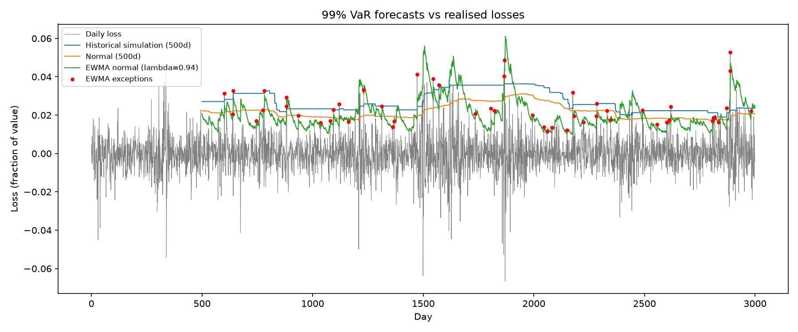
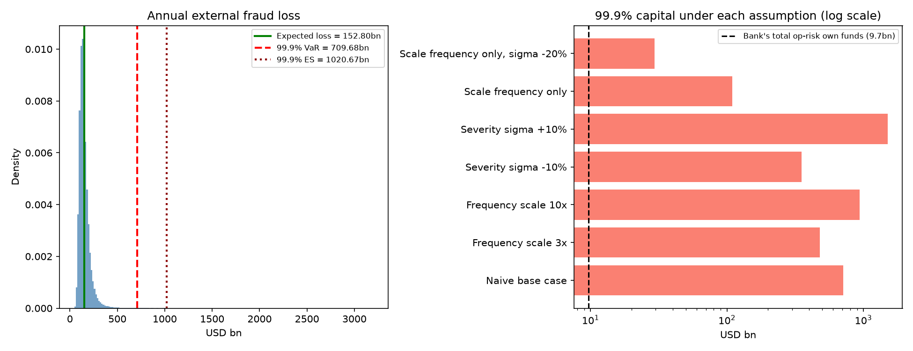
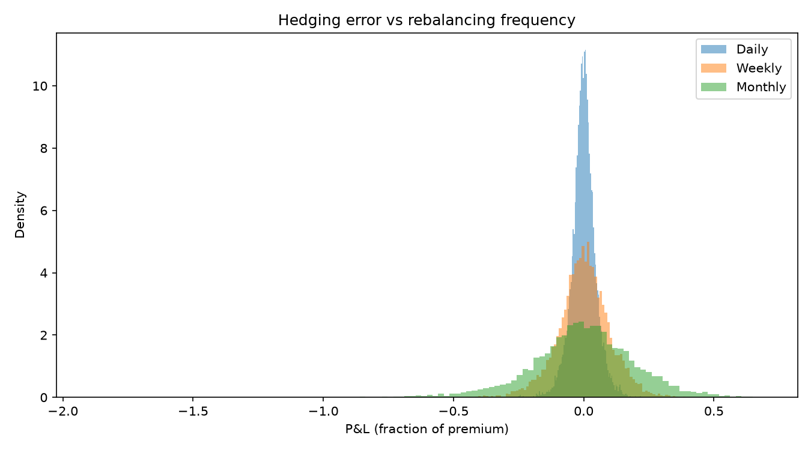

# market-risk-toolkit

Small, tested Python implementations of core market risk methods, each with a
worked example and an honest look at where the model breaks.

**Author:** Victor Martins Duque Estrada Zeitune, MSc Banking & Finance (Queen Mary
University of London, 2026, Merit). [LinkedIn](https://www.linkedin.com/in/victormartinszeitune)

| # | Project | What it shows |
|---|---------|---------------|
| 1 | [VaR models and backtesting](#1-var-models-and-backtesting) | Historical, normal and EWMA VaR; Kupiec, Christoffersen and Basel traffic-light tests |
| 2 | [Operational risk capital (LDA)](#2-operational-risk-capital-lda) | Poisson–lognormal Monte Carlo at 99.9%, sensitivity analysis and a reasonableness check that the naive calibration fails |
| 3 | [Delta hedging](#3-delta-hedging) | Black–Scholes hedging error vs rebalancing frequency and volatility mis-specification |

```bash
python -m venv .venv && source .venv/bin/activate
pip install -r requirements.txt
python examples/01_var_backtest.py      # or 02_oprisk_lda.py, 03_delta_hedging.py
pytest                                  # 14 tests
```

---

## 1. VaR models and backtesting

`mrt/var_es.py`, `mrt/backtest.py`, `examples/01_var_backtest.py`

One-day 99% VaR from three models, forecast every day over 2,500 days, then
backtested. The data are simulated from a GARCH(1,1) process with Student-t
shocks, which has the two features that break simple models: fat tails and
volatility clustering. (Pass a CSV with a `close` column to run it on real prices.)

| Model | Exceptions | Expected | Kupiec p | Christoffersen p | Traffic light (last 250d) |
|---|---|---|---|---|---|
| Historical simulation (500d) | 33 | 25 | 0.125 | 0.001 | yellow |
| Normal (500d) | 53 | 25 | 0.000 | 0.001 | red |
| EWMA normal (λ = 0.94) | 51 | 25 | 0.000 | 0.392 | yellow |



**Reading the results**
- **Normal VaR fails both tests**: the tails are too thin (twice the expected
  exceptions) and it reacts too slowly when volatility rises, so exceptions cluster.
- **Historical simulation gets the count roughly right but fails independence.**
  A 500-day window is slow to react, so exceptions bunch together in volatile periods.
- **EWMA fixes the clustering** (Christoffersen passes) because volatility updates
  daily, **but still has too many exceptions** because it assumes normal tails.
- The obvious next model combines the two fixes: filtered historical simulation
  or EWMA/GARCH with Student-t shocks.

Expected Shortfall is implemented for each method (historical, normal and
Student-t in closed form, Monte Carlo); the tests check the Student-t formula
against simulation.

## 2. Operational risk capital (LDA)

`mrt/oprisk_lda.py`, `examples/02_oprisk_lda.py`

Built on an MSc group project (ECOM055 Risk Management for Banking, Queen Mary).
**My part was the Monte Carlo engine**, rewritten here as `mrt/oprisk_lda.py`.
The frequency and severity calibration was a group effort, and the parameters
are reused with credit to my teammates; their parts of the report (data
collection, distribution fitting and the written analysis) are not included. Annual external-fraud losses at a large
bank are simulated as a Poisson number of lognormal losses, and capital is the
99.9% quantile of 100,000 simulated years.

The calibration fits frequency and severity to public industry loss events
(ORX News) and scales them to the bank's size. **The useful part is the check
afterwards:**

| Scenario | 99.9% VaR (USD bn) | × bank's total op-risk own funds |
|---|---|---|
| Naive base case | 709.7 | 73.2 |
| Severity σ −10% | 351.2 | 36.2 |
| Severity σ +10% | 1,503.0 | 154.9 |
| Scale frequency only | 109.8 | 11.3 |
| Scale frequency only, σ −20% | 29.4 | 3.0 |



The naive calibration produces external-fraud capital **73 times** the bank's
published own-funds requirement for **all** operational risk (USD 9.7bn, Pillar 3).
A model that fails a reasonableness check this badly should not be used. The
sensitivity table shows why:

1. **Double counting size.** Scaling both how often losses happen and how big
   they are by bank size multiplies the effect.
2. **Data bias.** ORX News records large, public events, so the severity
   distribution is biased upwards. Internal loss data would have far more small losses.
3. **Tail sensitivity.** A 10% change in the lognormal σ roughly halves or doubles
   capital. This parameter needs the most scrutiny and a fit test focused on the tail.

## 3. Delta hedging

`mrt/options.py`, `examples/03_delta_hedging.py`

Sell a one-year at-the-money call at its Black–Scholes price and delta-hedge it
over 10,000 simulated paths.

| Rebalancing | Hedge vol (true = 20%) | Mean P&L (% premium) | Std (% premium) |
|---|---|---|---|
| Daily | 20% | +0.0% | 4.7% |
| Weekly | 20% | +0.0% | 10.2% |
| Monthly | 20% | −0.2% | 20.2% |
| Daily | 15% | −26.2% | 13.0% |
| Daily | 25% | +17.4% | 7.1% |



- With the right volatility the hedge is unbiased, and the error falls roughly
  with the square root of the rebalancing interval.
- Hedging with the wrong volatility is far more costly than hedging less often:
  under-estimating vol by 5 points loses a quarter of the premium on average.

---

## Roadmap

- [ ] Run project 1 on real equity and FX data; add filtered historical simulation and GARCH-t VaR
- [ ] Stress tests: 2022 gilt/LDI shock, a BRL devaluation, March 2020
- [ ] Fixed income: DV01 / key-rate durations for a bond portfolio
- [ ] Short validation-style write-up for each project

## Notes

- Everything here is rewritten from scratch as reusable functions. No course
  data, assignment questions or answers are included.
- Simulated data are used where real data cannot be redistributed.
